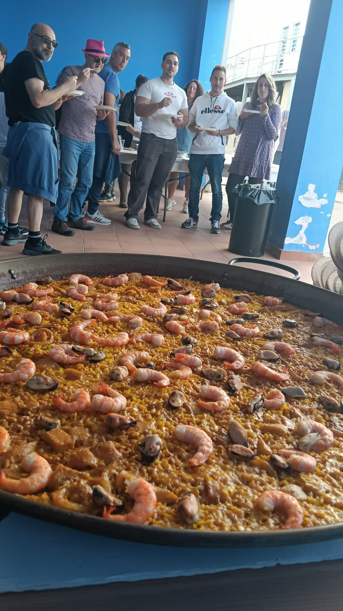

Este año se nos ha ido el tiempo de las manos, y la habitual <i><b>Convivencia de Socios</b></i> que solemos celebrar en septiembre se escapó a noviembre. Y cómo el clima durante ese mes es más inestable, lo hicimos en las instalaciones municipales de la <b>Zona Joven</b> de Almendralejo. Este año con paella incluída.

Como novedad, este año hemos traído una <b>paella</b> a compartir, junto con algunas raciones para tener un menú variado, y así eliminar la carga que años anteriores se trasladó a los socios para traer suministros y viandas.

Tampoco hubo 'dinamización especial' (el primer año hubo Toyio Train LIVE, y el segundo año hubo Duelo del Té). Lo que si hubo, ya que teníamos el espacio adecuado, fue mesas para jugar partidas depués de la sobre mesa.

Este año nos dimos cita entorno a unos veinte socios. Por la tarde hubo un cambio de unos 5 o 6 (socios que se fueron después de comer, y socios que vinieron a sustituirles). Y por la noche hubo otro cambio de 3 o 4.

Este tipo de 'evento-actividad', que rompe comn las típicas quedadas de fin de semana, viene muy bien para reconectar con el resto de miembros que suelen ser poco habituales. Es una alegría ver que no se pierde el contacto.
