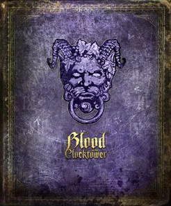
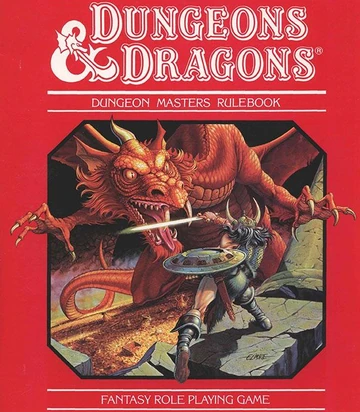
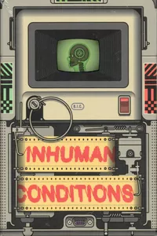

# Info

El **sábado 26 de diciembre de 2026**, la Asociación Cultural CSI Badajoz organiza una jornada para disfrutar de juegos de rol y juegos sociales en el **Espacio para la Creación Joven (ECJ) de Almendralejo**, a partir de las **16:00**.

La jornada está **abierta a todo el mundo a partir de los 16 años**. Habrá **partidas organizadas** y también **partidas improvisadas**.

## Juegos

Estos son los juegos que hemos seleccionado hasta el momento. Estamos abiertos a incorporar otros juegos, así que si tienes alguna propuesta, ¡cuéntanosla!

### Partidas con preinscripción previa

La participación en *Blood on the Clocktower*, *Dungeons & Dragons* y *Blade Runner* requiere [preinscripción mediante este formulario de Google](https://docs.google.com/forms/d/e/1FAIpQLSdm-x3Tox440SuVtBQwadUBNFyUBgy1GRjMpF73Or3fHSfG8Q/viewform?usp=header). Indica tus juegos por orden de preferencia; si no hay plazas en la primera opción, tendremos en cuenta la siguiente.

#### Blood on the Clocktower

**5–21 jugadores · 2–3 horas**

#### Dungeons & Dragons

**3–6 jugadores · 3–4 horas**

#### Blade Runner

**3–4 jugadores · 3–4 horas**

### Partidas espontáneas

*2 Rooms and a Boom* e *Inhuman Conditions* se jugarán de forma improvisada cuando se formen grupos o haya personas interesadas entre quienes asistan a las jornadas.

#### 2 Rooms and a Boom

**6–30 jugadores · 20 minutos**

#### Inhuman Conditions

**2 jugadores · 10 minutos**

